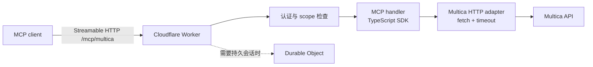

# Multica MCP on Cloudflare Workers：语言与实现方案分析

## 结论

推荐使用 **TypeScript + Cloudflare Workers**，以 Cloudflare 官方 MCP handler 和 MCP TypeScript SDK 实现 Streamable HTTP。Go 版本的 `workctl` 适合作为功能和参数的参考实现，但不适合直接作为 Worker 运行时。第一阶段应做无状态、只读的 MCP endpoint；只有在需要会话恢复、订阅或长连接状态时才引入 Durable Objects。

最大的前置条件是 Multica 的服务端 HTTP API。当前 `workctl` 的 MCP 实现通过本机 `multica` 可执行文件完成所有 Multica 操作；Worker 不能依赖这个 CLI，因此必须确认一个可从 Worker 访问的、带 workspace 授权的 Multica HTTP API，或单独部署一个 API gateway。

## 现有实现能复用什么

`workctl` 已经提供了工具清单、输入校验和 JSON 输出约定：

- `internal/cmdmcp` 注册 Linear、agent、issue 和委派工具。
- `internal/mcpserver/server.go` 实现的是 stdio 上的 newline-delimited JSON-RPC，传输层不是 HTTP。
- `internal/multicacli/client.go` 用 `os/exec` 启动 `multica`，并把 stdout 校验为 JSON。
- `docs/mcp.md` 记录了现有工具参数、只读模式和 workspace 选择规则。

因此可以复用工具名称、schema 和返回字段，重写执行层为 `fetch` 调用。不能把 Go binary、stdin/stdout server 或 CLI token 配置直接打包进 Worker。

## 语言选择

| 方案 | 结论 | 原因 |
| --- | --- | --- |
| TypeScript | **推荐** | Workers 原生运行 Web API；Cloudflare 官方 MCP 示例和 SDK 是 TypeScript；`fetch`、`Request`、`Response`、流式响应和 Wrangler 部署都直接可用。 |
| Go | 不推荐 | 当前实现依赖 `os/exec` 和 stdio。Worker 没有可依赖的本地 CLI 进程模型；即使编译成 WASM，也要重新适配 Web 请求、流和绑定，无法复用现有执行路径。 |
| Rust/WASM | 可行但不划算 | 可生成 WASM，但 MCP、Workers binding 和 Streamable HTTP 的现成集成少于 TypeScript，团队还要承担 FFI 和构建复杂度。 |
| Python | 不推荐 | 不是 Workers 的主运行时，无法直接复用现有 Go 代码；需要额外的 WASM/Pyodide 运行时和更大的包体。 |

## 推荐架构

1. Worker 在 `/mcp/multica` 暴露 MCP Streamable HTTP。使用官方 handler 处理 JSON-RPC、内容协商、协议版本和错误格式，不自行复制 transport 细节。将每个 MCP 放在独立路径下，后续可以在同一个 Worker 增加其他 MCP。
2. 每个 tool handler 只做参数校验、权限检查和 Multica API 调用；不要把原始 token、完整认证上下文或内部错误写回 MCP 内容。
3. Multica adapter 统一处理 base URL、Bearer token、workspace header、超时和错误映射。读请求可以有限重试，写请求必须依赖幂等键或不重试。
4. 只读无状态服务可直接每请求创建 MCP server。若要支持会话恢复、事件重放或订阅，再用 Durable Object 保存 session/event store。

Cloudflare 官方 `mcp-server` 示例使用 `@modelcontextprotocol/server` 的 `createMcpHandler`，由 Worker 的 `fetch` handler 接收 Streamable HTTP 请求；官方 transport 文档也明确区分了无状态 handler 与需要 Durable Object 的有状态实现。

## 与 Multica 的集成边界

目前本地代码没有 Multica HTTP API client：`workctl` 通过 `multica agent ...`、`multica issue ...` 等子命令执行。这是实现前必须解决的接口问题：

- 确认 API base URL、认证方式、workspace 选择、分页格式和错误格式。
- 为 agent/issue/comment 的读操作定义稳定的 HTTP DTO；不要让 Worker 依赖 CLI 的终端输出。
- 将写操作按权限拆分，至少区分 `mcp:read` 和 `mcp:write` scope。
- 把 `set_multica_agent_env`、avatar 上传、删除/归档、状态变更等高影响工具从默认公开清单移除，或单独放到受保护的写入 endpoint。
- 若只能使用 CLI，部署形态应改为“Worker + 受保护的 CLI gateway”；这会增加运行服务、凭据转发和可用性成本，不应作为第一选择。

建议 MVP 先暴露 `get/list` agent、issue、comment 等只读工具，验证 MCP client 兼容性和 Multica API，再逐组加入创建、更新、委派和运行控制工具。工具名字和输入 schema 可沿用 `workctl`，但执行逻辑应由 TypeScript adapter 实现。

## 认证、配置与部署

- 使用 Cloudflare Worker secrets 保存 `MULTICA_API_TOKEN`；将 `MULTICA_SERVER_URL`（self-host 地址，默认 `https://api.multica.ai`）和默认 workspace 作为环境变量，开发/生产分别配置。`MULTICA_API_URL` 作为兼容别名保留。
- MCP 客户端是第三方调用者时，按 MCP 授权规范接入 OAuth 2.1；Cloudflare 的 `workers-oauth-provider` 可以负责 token endpoint 和验证，tool handler 仍需自行检查 scope。
- 如果只是内部单租户服务，可以先用固定 Bearer token 或 Cloudflare Access，之后再升级 OAuth；不要把 Multica 长期 token 放在客户端。
- `wrangler.jsonc` 至少声明 Worker entrypoint、compatibility date、环境变量和（有状态方案才需要的）Durable Object binding/migration。
- 生产请求需要 CORS、请求体大小限制、上游超时、结构化日志和 token 脱敏。Multica 上游错误应转换为可诊断但不泄露凭据的 MCP tool error。

## 验证计划

在实现阶段加入以下检查：

1. 用 MCP Inspector 和一个真实 MCP client 验证 initialize、tools/list、tools/call、协议版本协商以及 Streamable HTTP 的 GET/POST 行为。
2. 用 Vitest 和 Cloudflare Workers 测试池运行 Worker handler；用 MSW 或 `fetch` stub 模拟 Multica API，覆盖 401、超时、分页、上游 5xx 和写操作幂等性。
3. 为每个公开 tool 固化 JSON schema 快照，确保从 `workctl` 迁移时字段名和嵌套结构不变。
4. 在部署前执行 `wrangler deploy --dry-run`、TypeScript 类型检查和最小的远程 smoke test；不要在测试中调用本机 `multica` CLI。

## 依据

- [workctl MCP guide](https://github.com/kongken/workctl/blob/cc0dfe4f89c0efbbce6b15aa0fe7c68e3c790ec9/docs/mcp.md)：现有 transport、工具和 CLI 配置约定。
- [workctl MCP server](https://github.com/kongken/workctl/blob/cc0dfe4f89c0efbbce6b15aa0fe7c68e3c790ec9/internal/mcpserver/server.go)：stdio JSON-RPC 实现。
- [workctl Multica CLI adapter](https://github.com/kongken/workctl/blob/cc0dfe4f89c0efbbce6b15aa0fe7c68e3c790ec9/internal/multicacli/client.go)：`os/exec` 和 JSON 校验路径。
- [Cloudflare Agents MCP server example](https://github.com/cloudflare/agents/tree/366d5b5baf846b4669a2ecd0e61e104aa634432b/examples/mcp-server)：Worker 上的 TypeScript `createMcpHandler` 示例。
- [Cloudflare MCP transports](https://github.com/cloudflare/agents/blob/366d5b5baf846b4669a2ecd0e61e104aa634432b/docs/agents/mcp-transports.md)：Streamable HTTP 的无状态与有状态边界。
- [Cloudflare securing MCP servers](https://github.com/cloudflare/agents/blob/366d5b5baf846b4669a2ecd0e61e104aa634432b/docs/agents/securing-mcp-servers.md)：OAuth provider、scope 检查和敏感认证上下文处理。
- [MCP transport specification](https://modelcontextprotocol.io/specification/2025-06-18/basic/transports#streamable-http)：Streamable HTTP 的请求、响应和 session 语义。

